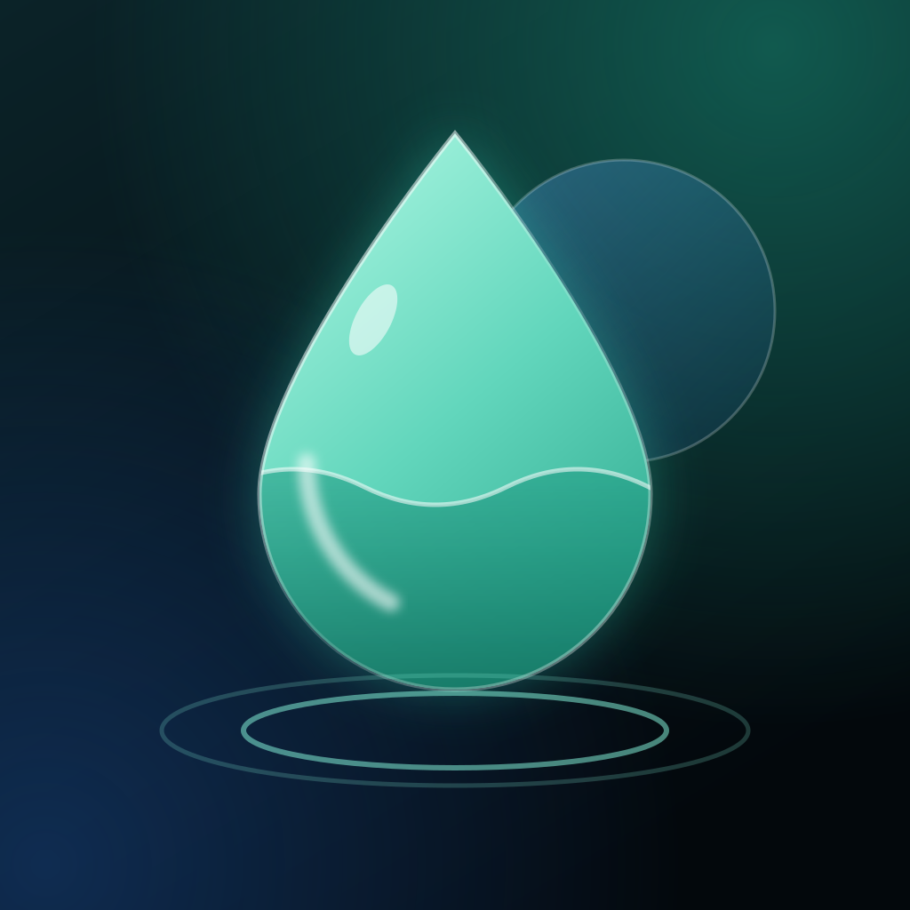

<div align="center">



# Triveni Controller

**A local-first Android controller and ESP32 water-pump research prototype.**

<sub>Bench research only · Water only · Never connect to a person or use to deliver medication</sub>

[Screenshots](#screenshots) · [How it works](#how-it-works) · [Setup](#hardware-and-firmware-setup) · [Build the app](#build-the-android-app) · [Safety](#safety)

</div>

---

Triveni combines an Android companion app with an ESP32 controller for a small peristaltic pump. The app communicates directly with the device over its local Wi-Fi access point. Pump control, sensor checks, dose limits, and fault handling run on the ESP32, so the hardware remains responsible for its own safety if the phone disconnects.

> **Important:** This is an experimental, water-only bench prototype. It is not a medical device. Never connect it to a person, an animal, an IV line, or medication.

## Contents

- [App guide](docs/APP_GUIDE.md)
- [Screenshots](#screenshots)
- [Features](#features)
- [How it works](#how-it-works)
- [Hardware and firmware setup](#hardware-and-firmware-setup)
- [Build the Android app](#build-the-android-app)
- [Security notes](#security-notes)
- [Repository map](#repository-map)
- [Project reference](#project-reference)

## Screenshots

| Dashboard | Calibration | Device history |
|:--:|:--:|:--:|
|  |  |  |

| Settings | Device settings | Theme selection |
|:--:|:--:|:--:|
|  |  |  |

| Data export |
|:--:|
|  |

## Features

### Android companion app

- **Live dashboard:** connection state, session progress, flow, pressure, motor output, and current readings.
- **Pump controls:** start, pause, resume, acknowledge, and a prominent red stop action.
- **Calibration:** run a supervised water test and save measured calibration values.
- **Device history:** inspect recorded telemetry, sessions, calibration results, and alarms.
- **Data export:** select device, date range, and categories; export CSV, JSON, or PDF.
- **Appearance:** Glass, Light, and OLED themes.
- **Local storage:** history stays on the phone until the user chooses to share an export.

### ESP32 controller

- Closed-loop flow control using drop-sensor measurements and a bounded PID controller.
- Configurable PWM limits and a physical speed-limit knob.
- Physical stop input, pressure-based occlusion detection, no-flow detection, and latched faults.
- OLED status, audible and visual alarms, and a task watchdog.
- Three-drop target in the current prototype configuration.
- Local Wi-Fi API for status and command exchange; no cloud service is used.

## How it works

```mermaid
%% Generated by https://gitdiagram.com/abhinavdatta/triveni-an-iot-enabled-medical-device
flowchart TD

subgraph group_app["Android app"]
  node_activity["Screen navigation<br/>[MainActivity.kt]"]
  node_home["Live dashboard<br/>[HomeFragment.kt]"]
  node_calibrate["Calibration"]
  node_settings["Settings"]
  node_device_settings["Device settings"]
  node_theme["Theme selection<br/>[ThemeFragment.kt]"]
  node_theme_manager["Theme manager<br/>[ThemeManager.kt]"]
end

subgraph group_device["Device connection"]
  node_registry[("Device registry<br/>[DeviceRegistry.kt]")]
  node_viewmodel["Polling and commands<br/>[MainViewModel.kt]"]
  node_http_client["Local HTTP client<br/>[Esp32Client.kt]"]
  node_status["Status parser<br/>[DeviceStatus.kt]"]
end

subgraph group_records["Records and export"]
  node_history["History viewer<br/>[HistoryFragment.kt]"]
  node_export_screen["Export selection<br/>[ExportFragment.kt]"]
  node_export_utils["Export formats<br/>[ExportUtils.kt]"]
  node_recorder[("Local recorder<br/>[DataRecorder.kt]")]
  node_event_log[("Event log<br/>[EventLog.kt]")]
end

subgraph group_firmware["ESP32 controller"]
  node_esp_api["ESP32 local API<br/>[smart_pump.ino]"]
  node_pump_control["Pump safety control<br/>[smart_pump.ino]"]
end

subgraph group_hardware["Pump hardware"]
  node_sensors["Sensors and STOP"]
  node_pump_outputs["Pump and alarms"]
end

node_user(("Phone user"))

node_user -->|"uses"| node_activity
node_activity -->|"routes"| node_home
node_activity -->|"routes"| node_calibrate
node_activity -->|"routes"| node_history
node_activity -->|"routes"| node_settings
node_activity -->|"routes"| node_device_settings
node_activity -->|"routes"| node_theme
node_activity -->|"routes"| node_export_screen
node_activity -->|"applies theme"| node_theme_manager
node_theme -->|"selects theme"| node_theme_manager
node_home -->|"requests commands"| node_viewmodel
node_viewmodel -->|"polls and sends"| node_http_client
node_http_client -->|"HTTP requests"| node_esp_api
node_esp_api -->|"returns status"| node_http_client
node_viewmodel -->|"parses response"| node_status
node_viewmodel -->|"records telemetry"| node_recorder
node_viewmodel -->|"logs events"| node_event_log
node_activity -->|"loads records"| node_recorder
node_activity -->|"loads devices"| node_registry
node_home -->|"lists devices"| node_registry
node_settings -->|"opens settings"| node_device_settings
node_history -->|"shows events"| node_event_log
node_export_screen -->|"selects device"| node_registry
node_export_screen -->|"builds export"| node_export_utils
node_export_utils -->|"reads records"| node_recorder
node_sensors -->|"measure and stop"| node_pump_control
node_pump_control -->|"drives and alarms"| node_pump_outputs
node_esp_api -->|"dispatches commands"| node_pump_control

click node_activity "https://github.com/abhinavdatta/triveni-an-iot-enabled-medical-device/blob/master/app/src/main/java/com/waterbench/controller/MainActivity.kt"
click node_home "https://github.com/abhinavdatta/triveni-an-iot-enabled-medical-device/blob/master/app/src/main/java/com/waterbench/controller/HomeFragment.kt"
click node_calibrate "https://github.com/abhinavdatta/triveni-an-iot-enabled-medical-device/blob/master/app/src/main/java/com/waterbench/controller/CalibrateFragment.kt"
click node_settings "https://github.com/abhinavdatta/triveni-an-iot-enabled-medical-device/blob/master/app/src/main/java/com/waterbench/controller/SettingsFragment.kt"
click node_device_settings "https://github.com/abhinavdatta/triveni-an-iot-enabled-medical-device/blob/master/app/src/main/java/com/waterbench/controller/DeviceSettingsFragment.kt"
click node_theme "https://github.com/abhinavdatta/triveni-an-iot-enabled-medical-device/blob/master/app/src/main/java/com/waterbench/controller/ThemeFragment.kt"
click node_theme_manager "https://github.com/abhinavdatta/triveni-an-iot-enabled-medical-device/blob/master/app/src/main/java/com/waterbench/controller/ThemeManager.kt"
click node_history "https://github.com/abhinavdatta/triveni-an-iot-enabled-medical-device/blob/master/app/src/main/java/com/waterbench/controller/HistoryFragment.kt"
click node_export_screen "https://github.com/abhinavdatta/triveni-an-iot-enabled-medical-device/blob/master/app/src/main/java/com/waterbench/controller/ExportFragment.kt"
click node_export_utils "https://github.com/abhinavdatta/triveni-an-iot-enabled-medical-device/blob/master/app/src/main/java/com/waterbench/controller/ExportUtils.kt"
click node_recorder "https://github.com/abhinavdatta/triveni-an-iot-enabled-medical-device/blob/master/app/src/main/java/com/waterbench/controller/DataRecorder.kt"
click node_event_log "https://github.com/abhinavdatta/triveni-an-iot-enabled-medical-device/blob/master/app/src/main/java/com/waterbench/controller/EventLog.kt"
click node_registry "https://github.com/abhinavdatta/triveni-an-iot-enabled-medical-device/blob/master/app/src/main/java/com/waterbench/controller/DeviceRegistry.kt"
click node_viewmodel "https://github.com/abhinavdatta/triveni-an-iot-enabled-medical-device/blob/master/app/src/main/java/com/waterbench/controller/MainViewModel.kt"
click node_http_client "https://github.com/abhinavdatta/triveni-an-iot-enabled-medical-device/blob/master/app/src/main/java/com/waterbench/controller/Esp32Client.kt"
click node_status "https://github.com/abhinavdatta/triveni-an-iot-enabled-medical-device/blob/master/app/src/main/java/com/waterbench/controller/DeviceStatus.kt"
click node_esp_api "https://github.com/abhinavdatta/triveni-an-iot-enabled-medical-device/blob/master/firmware/esp32/smart_pump.ino"
click node_pump_control "https://github.com/abhinavdatta/triveni-an-iot-enabled-medical-device/blob/master/firmware/esp32/smart_pump.ino"

classDef toneNeutral fill:#f8fafc,stroke:#334155,stroke-width:1.5px,color:#0f172a
classDef toneBlue fill:#dbeafe,stroke:#2563eb,stroke-width:1.5px,color:#172554
classDef toneAmber fill:#fef3c7,stroke:#d97706,stroke-width:1.5px,color:#78350f
classDef toneMint fill:#dcfce7,stroke:#16a34a,stroke-width:1.5px,color:#14532d
classDef toneRose fill:#ffe4e6,stroke:#e11d48,stroke-width:1.5px,color:#881337
classDef toneIndigo fill:#e0e7ff,stroke:#4f46e5,stroke-width:1.5px,color:#312e81
classDef toneTeal fill:#ccfbf1,stroke:#0f766e,stroke-width:1.5px,color:#134e4a
class node_activity,node_home,node_calibrate,node_settings,node_device_settings,node_theme,node_theme_manager,node_user toneBlue
class node_registry,node_viewmodel,node_http_client,node_status toneAmber
class node_history,node_export_screen,node_export_utils,node_recorder,node_event_log toneMint
class node_esp_api,node_pump_control toneRose
class node_sensors,node_pump_outputs toneIndigo
```



The Android app requests device status and sends user commands. Sensor validation, pump limits, dose completion, and fault latching remain in firmware. The physical STOP and firmware interlocks must remain functional independently of the app.

### Local API

| Route | Method | Purpose |
|---|---|---|
| `/api/status` | `GET` | Read controller state and telemetry as JSON. |
| `/api/command` | `POST` | Send a supported controller command as form data or JSON. |

Supported command examples include `START`, `PAUSE`, `STOP`, `ACK_ALARM`, `RESUME`, `SET_FLOW 2.0`, and `SET_WIFI_NAME Triveni_02`. The firmware validates commands and enforces local operating limits.

## Hardware and firmware setup

The ESP32 firmware is in [`firmware/esp32/smart_pump.ino`](firmware/esp32/smart_pump.ino). The current wiring uses an ESP32, TB6612FNG motor driver, small 5 V peristaltic pump, IR drop sensor, HX710B pressure module, INA219 current monitor, SSD1306 OLED, physical STOP button, LED, buzzer, and a speed-limit potentiometer.

### First boot and Wi-Fi

1. Flash the firmware and open the serial monitor at **115200 baud**.
2. On first boot, the ESP32 generates and stores a unique Wi-Fi password and prints it once to the serial console. Save it securely.
3. Join the `Triveni-ESP32` network from the phone. The API is available at `http://192.168.4.1` while connected to that device network.
4. Open the app and confirm the connection and telemetry before trying pump controls.

The firmware uses a physical STOP input and independent interlocks. Verify them with water on the bench before any pump run. Firmware defaults are experimental and must be calibrated with the actual sensors and tubing.

### Wiring reference

| Function | ESP32 connection |
|---|---|
| Motor driver AIN1 / AIN2 / PWMA | GPIO 25 / 26 / 27 |
| Physical STOP input | GPIO 33 |
| Drop sensor output | GPIO 32 |
| HX710B DOUT / SCK | GPIO 13 / 14 |
| Speed-limit potentiometer wiper | GPIO 34 |
| OLED and INA219 SDA / SCL | GPIO 21 / 22 |
| Alarm LED | GPIO 4 |
| Buzzer control | GPIO 23 |

Use a common ground. Keep the sensor and ESP32 logic at 3.3 V where specified. Disconnect power before changing wiring. For the complete assembly guide, parts list, and annotated wiring details, see the [Schematik project reference](https://www.schematik.io/projects/iot-enabled-medical-device-jry3).

## Build the Android app

### Requirements

- JDK 17
- Android SDK with API 34 installed
- Gradle 8.7 or compatible Android Gradle Plugin 8.5.2 tooling

Build a debug APK with:

```powershell
gradle assembleDebug
```

The debug APK is written to `app/build/outputs/apk/debug/app-debug.apk`.

### Signed release build

Release signing secrets must stay outside Git. On the Windows workstation where the replacement key was generated, the helper reads a DPAPI-encrypted password stored under the current Windows user profile and supplies the environment variables to Gradle:

```powershell
./scripts/build_release.ps1
```

For another build machine or CI runner, configure these environment variables in its protected secret store:

```text
WATERBENCH_RELEASE_STORE_FILE      Absolute path to the keystore
WATERBENCH_RELEASE_STORE_PASSWORD  Keystore password
WATERBENCH_RELEASE_KEY_ALIAS       Signing key alias
WATERBENCH_RELEASE_KEY_PASSWORD   Signing key password
```

Then build:

```powershell
gradle assembleRelease
```

The signed APK is written to `app/build/outputs/apk/release/app-release.apk`. Keep the keystore and credentials in a secure secret store, maintain an independent backup, and never commit them.

The checked-in [`dist/WaterBench-Controller-v1.1-release.apk`](dist/WaterBench-Controller-v1.1-release.apk) predates the Triveni rebrand and still displays the former app name. Build a fresh release from this source to get the Triveni label. That APK uses a replacement signing certificate, so Android will not install it as an in-place update over an app signed with the former certificate; uninstall the old app first, or use the original signing identity only if update continuity is required and its compromise has been addressed.

**Signing does not guarantee a Play Protect verdict.** Android signing establishes package identity and integrity. Play Protect can still warn or block based on app behavior, reputation, distribution source, and other signals; verify the final artifact with Google Play Console or Play Protect before distribution.

The Android app disables platform backup so local telemetry and device history are not included in Android Auto Backup.

## Security notes

- The ESP32 creates a random Wi-Fi password on first boot. Retrieve it from the serial console and restrict physical access to that console.
- The firmware rejects browser-origin requests and throttles API requests. The `STOP` command bypasses the command throttle so repeated stop requests are not delayed.
- The device API uses local HTTP, not TLS. Use the app only on the trusted ESP32 access point; do not expose the API to another network.
- CSV exports quote text fields and neutralize spreadsheet formula cells. JSON export strings use a JSON encoder.
- **The former release keystore was committed to Git and must be treated as compromised.** This revision removes it from the current repository tree and uses external signing credentials, but does not rewrite Git history. Rotate the release key and purge the old key from repository history before distributing through a trusted update channel. Existing APKs signed with the old key may not accept updates signed with a replacement key.

## Repository map

```text
app/                  Android app source, resources, and build configuration
firmware/esp32/       ESP32 pump controller firmware
docs/screenshots/     App screenshots
docs/APP_GUIDE.md     App usage, setup, safety, and build guide
icons/                Launcher icon source artwork and previews
scripts/              Icon generation and signed release build helpers
dist/                 Versioned signed release APK
```

## Project reference

The original hardware guide and project notes are available at [schematik.io](https://www.schematik.io/projects/iot-enabled-medical-device-jry3).
