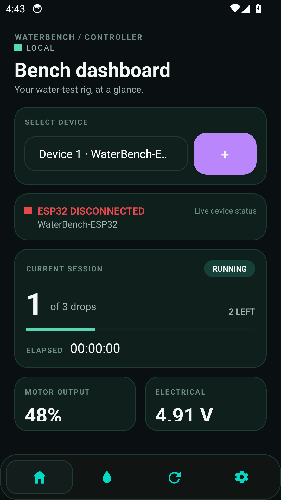
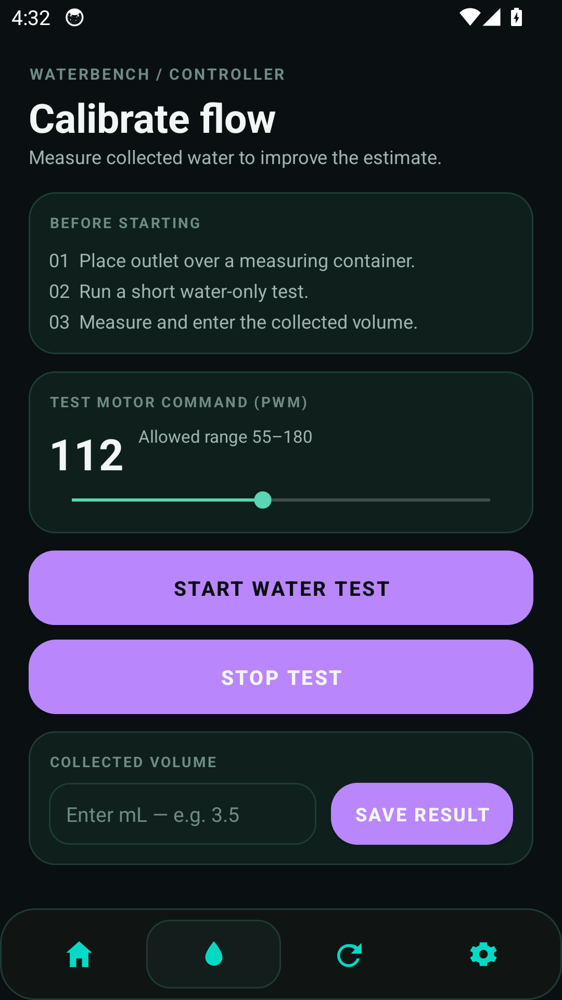
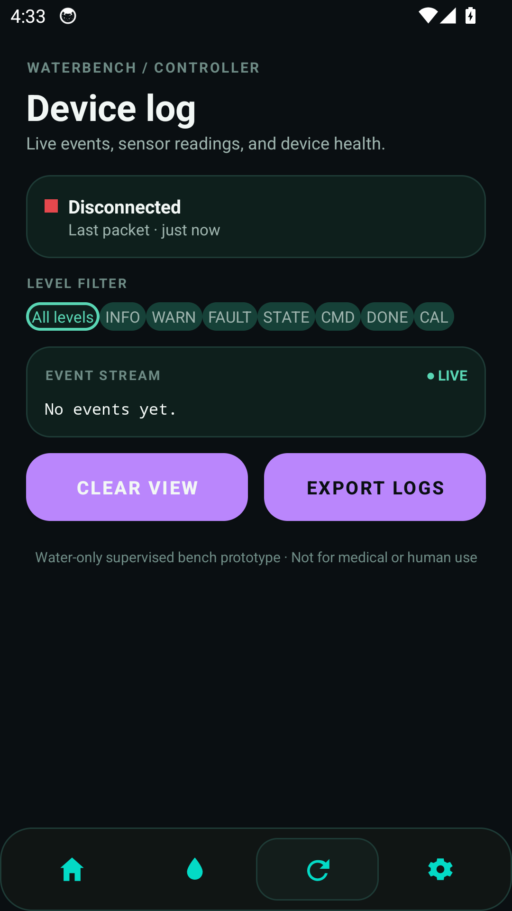
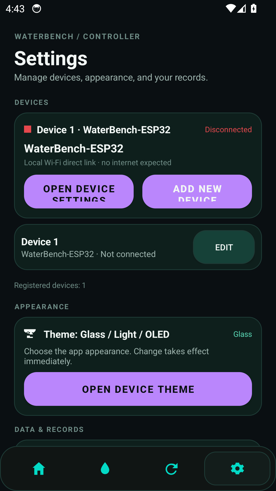
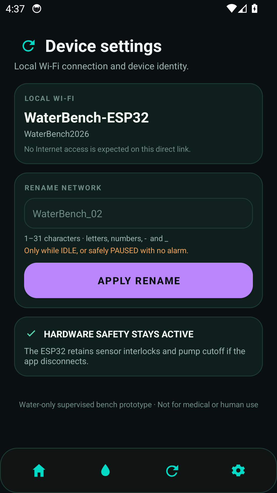
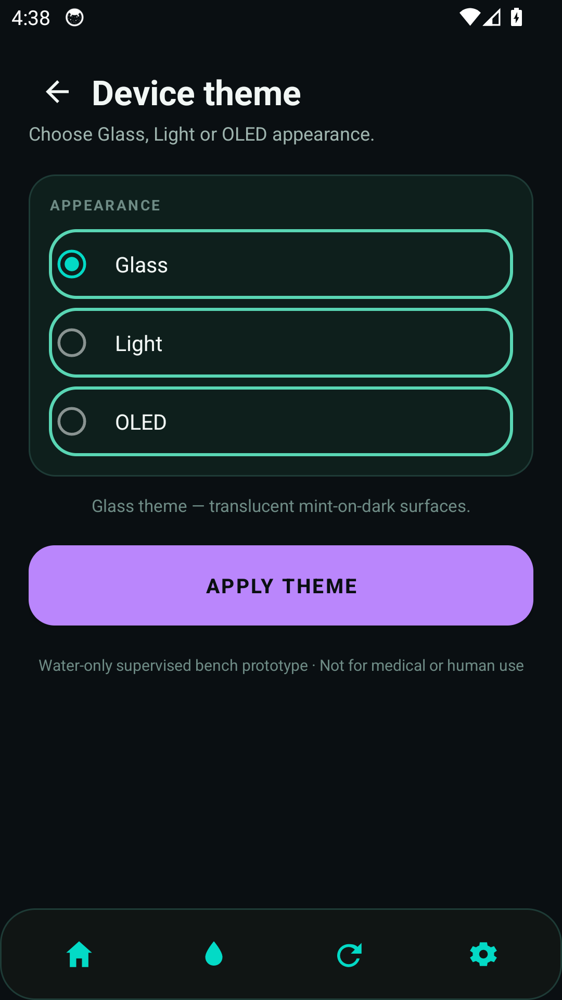
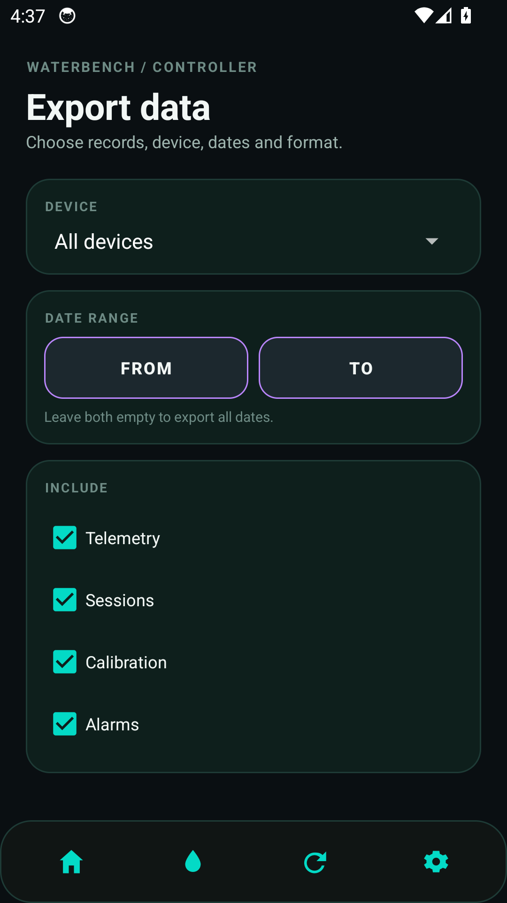

# WaterBench Controller — IoT-Enabled Bench Pump Prototype

<p align="center">
  
</p>

**Water-only supervised bench prototype · Not for medical or human use.**

Companion Android app + ESP32 firmware for a smart micro-pump research rig: local Wi‑Fi control, closed-loop flow regulation, drop counting, occlusion detection, safety alarms, and CSV/JSON/PDF data export.

> Full build guide, wiring diagram and annotated firmware: [schematik.io — IoT enabled medical device](https://www.schematik.io/projects/iot-enabled-medical-device-jry3)

---

## App screenshots

| Bench dashboard | Calibrate flow |
| --- | --- |
|  |  |

| Device log | Settings |
| --- | --- |
|  |  |

| Device settings | Device theme |
| --- | --- |
|  |  |

| Export data |
| --- |
|  |

---

## Overview

This project builds a water-only bench research prototype for studying peristaltic pump control and flow monitoring. The ESP32 microcontroller orchestrates a TB6612FNG motor driver to regulate pump speed, monitors flow via infrared drop detection, and reads pressure data to detect occlusions. Assembly includes power distribution, motor control wiring, a physical emergency stop button, drop-rate sensing, pressure monitoring, an OLED display, and audible/visual alarms.

The repository ships a complete wiring diagram, parts list, and annotated firmware with a serial command interface for flow calibration and remote operation. The prototype includes safety features like watchdog timers, occlusion detection, and a latching fault state. **This is a research tool only — never connect to a person or use for drug delivery.**

## Android app — WaterBench Controller

A production Kotlin app that talks **directly** to the ESP32 over its own password-protected Wi‑Fi access point. No cloud, no account, no data leaves the device unless you explicitly export and share it.

| Screen | What it does |
| --- | --- |
| **Bench dashboard** | Device selector with multi-device support, live session progress (drops delivered / remaining), elapsed timer, motor output, electrical readings (INA219), pressure & flow, `SET_FLOW`, START / PAUSE / RESUME / ACK, and a large STOP PUMP control. |
| **Safety alert** | When the ESP32 reports a fault (occlusion, physical stop, no flow, sensor failure) the dashboard shows the alarm banner with the exact fault text; acknowledging never restarts the pump — the hardware interlocks stay authoritative. |
| **Calibrate flow** | Test motor command (55–180 PWM), start/stop a water test, enter collected volume, save the result — writes `drops/mL` back to the ESP32. |
| **Device log** | Live monitor with connection state, last packet time, auto-refresh note, level-filterable event stream (INFO / WARN / FAULT / STATE / CMD / DONE / CAL), **EXPORT LOGS** and CLEAR VIEW. |
| **Device settings** | Local Wi‑Fi identity (SSID + password), network rename (`SET_WIFI_NAME`, only while idle or safely paused), hardware-safety notice, recent events. |
| **Settings hub** | Registered devices list with per-device EDIT, add-new-device, appearance (Glass / Light / OLED themes), and data & records. |
| **Device theme** | Dedicated appearance page with live preview; unsaved changes prompt before leaving. |
| **Export data** | Choose device (or all), date range, record categories (telemetry · sessions · calibration · alarms) and format — **CSV** for spreadsheets, **JSON** for raw records, **PDF** report. Files stay on the device until you share them. |

Design system: **Material Glass** — translucent layered surfaces, restrained blur, fine borders and soft shadows, with Glass, Light and OLED themes that preserve contrast and hierarchy across all three.

Everything the app records (telemetry samples, dose sessions, calibration results, alarm events) is persisted locally and capped, so history survives restarts on low-end phones.

## ESP32 firmware

`firmware/esp32/smart_pump.ino` — water-only bench controller:

- **Closed-loop flow control**: PID (KP/KI/KD) on measured drops/s → mL/min, clamped by `MIN_PWM`/`MAX_PWM` and the physical speed knob.
- **Safety interlocks that never depend on the app**: physical STOP button (GPIO33, also gates the driver STBY), HX710B occlusion pressure (≥30 kPa latches `OCCLUSION_ALARM`), no-flow timeout, IR drop-sensor debouncing, task watchdog (4 s), and a latching fault state that requires explicit `ACK_ALARM` + `RESUME`.
- **3-drop dose target**: the pump stops and the buzzer/LED latch on after the configured number of detected drops.
- **Local Wi‑Fi AP**: `WaterBench-ESP32` / `WaterBench2026` (rename supported), serving a small HTTP API — no internet access expected on this direct link.
- **OLED status display**: dose progress, speed, current, pressure/alarm, and an `APP OK / APP --` link indicator.

### Serial commands (newline terminated)

```
SET_FLOW 2.0 | START | PAUSE | STOP | ACK_ALARM | RESUME
CAL 140 | CAL_RESULT 10.0 | CAL_STOP | STATUS | SET_WIFI_NAME WaterBench_02
```

### Local HTTP API

| Endpoint | Method | Purpose |
| --- | --- | --- |
| `/api/status` | GET | Full JSON status: state, fault, drops, flow, pressure, PWM, bus voltage/current, sensor presence |
| `/api/command` | POST | `command=START` (form) or `{"command":"START"}` (JSON) |

## Parts list

| Qty | Component | Notes |
| --- | --- | --- |
| 1 | TB6612FNG dual H-bridge motor-driver breakout | Controls the pump motor without sending motor current through the ESP32 |
| 1 | 5 V peristaltic micro-pump | 3–5 V, stall current below 1 A; liquid stays inside the silicone tube |
| 1 | TCRT5000 IR line-tracking sensor (LM393) | Drop detection — operate at 3.3 V |
| 1 | Push button (red, momentary, NO) | Physical STOP override |
| 1 | 5 V active buzzer | Fault audible alarm |
| 1 | LED (red, 5 mm) + 220 Ω resistor | Fault visual alarm |
| 1 | HX710B 0–40 kPa digital pressure sensor | Tubing occlusion monitoring |
| 1 | INA219 high-side current/voltage sensor | Pump supply voltage and current |
| 1 | SSD1306 0.96" 128×64 OLED (I²C) | On-device status display |
| 1 | 10 kΩ linear potentiometer | Maximum-speed knob (signal only, never in series with the pump) |
| 1 | NPN transistor (2N2222 / BC547) + 1 kΩ resistor | Low-side buzzer switch |
| 1 | 1N5819 Schottky diode | Buzzer flyback protection |
| 1 | 10 kΩ resistor | STOP pull-up |
| 1 | 0.1 µF + 100 µF capacitors | Driver logic decoupling and motor bulk |
| 1 | USB-C 5 V, 2 A adapter | Bench power |

## Assembly (11 steps)

1. **Keep this as a water-only bench rig** — place the ESP32, driver, sensors, screen and tubing on a dry breadboard; route water only into a measuring cup. Never connect this prototype to a person or medication.
2. **Make the shared power rails** — 5 V / GND from the supply; the ESP32 3V3 pin supplies the logic rail; every ground joins the same rail. Disconnect 5 V before moving wires.
3. **Put the pump power monitor in line** — INA219 `VIN+` → 5 V rail, `VIN−` → TB6612 `VM`, 100 µF across VM/GND. Do not bypass the INA219.
4. **Wire the motor driver and pump** — `VCC`→3V3, `AIN1`→GPIO25, `AIN2`→GPIO26, `PWMA`→GPIO27, unused channel B to GND, `A01/A02` → pump MOTOR±.
5. **Add the physical STOP override** — button pulls GPIO33 / TB6612 `STBY` low, with 10 kΩ pull-up to 3V3. Helpful hardware shutdown, not a certified e-stop.
6. **Wire and aim the drop sensor** — LM393/TCRT5000 `DO`→GPIO32 at 3.3 V; mount a few mm from the drop path and trim until the indicator toggles per drop. Never power it from 5 V.
7. **Wire the pressure module** — HX710B `DOUT`→GPIO13, `SCK`→GPIO14, hose open to air at zeroing; secure the port to downstream tubing.
8. **Wire the OLED and current monitor** — both share `SDA`→GPIO21 / `SCL`→GPIO22 at 3.3 V.
9. **Wire the alarm light and buzzer** — GPIO4 → 220 Ω → LED; GPIO23 → 1 kΩ → transistor base, collector to buzzer −, buzzer + to 5 V, 1N5819 across the buzzer.
10. **Add the pump-speed knob** — pot across 3V3/GND/wiper→GPIO34. It sets a speed limit only; never put it in series with the pump.
11. **Check the wireless app link and safety stops** — join `WaterBench-ESP32` (password `WaterBench2026`), have the app poll `GET http://192.168.4.1/api/status`, confirm the OLED flips to `APP OK`, test the physical STOP, then run a low-flow test and confirm three detected drops stop the pump and sound the buzzer.

## Wiring summary

| Function | Peripheral | ESP32 |
| --- | --- | --- |
| power | power supply +5V | 5V |
| ground | power supply GND | GND |
| digital / pwm | driver AIN1 / AIN2 / PWMA | GPIO 25 / 26 / 27 |
| digital | STOP button SIGNAL (also driver STBY) | GPIO 33 |
| digital | IR drop sensor DO | GPIO 32 |
| digital | HX710B DOUT / SCK | GPIO 13 / 14 |
| adc | speed pot WIPER | GPIO 34 |
| i2c | OLED + INA219 SDA / SCL | GPIO 21 / 22 |
| alarm | LED (via 220 Ω) | GPIO 4 |
| alarm | buzzer transistor base (via 1 kΩ) | GPIO 23 |

Full step-by-step wiring with per-connection tables: [the Schematik guide](https://www.schematik.io/projects/iot-enabled-medical-device-jry3).

## Building the app

```bash
# requires JDK 17 + Android SDK (ANDROID_HOME set)
gradle assembleRelease
# output: app/build/outputs/apk/release/app-release.apk
# prebuilt: dist/WaterBench-Controller-v1.0-release.apk
```

Launcher icons are generated from the master artwork:

```bash
python scripts/gen_launcher_icons.py
```

## Repository layout

```
app/                  Android app (Kotlin, Material Components)
firmware/esp32/       Smart micro-pump firmware (.ino)
docs/screenshots/     App screenshots used in this README
icons/                Master icon artwork (SVG + 1024 px PNG)
scripts/              Icon generation helper
dist/                 Prebuilt release APK
```

## Safety

- **Not a medical device.** Never connect to a person or use for IV/drug delivery.
- The app's Stop button supplements but never replaces the physical STOP button.
- The ESP32 retains all sensor interlocks and pump cutoff if the app disconnects.
- Do not run a dose if the drop sensor misses drops, the pressure module is not detected, or the OLED reports the INA219 missing.
- The HX710B reading is uncalibrated until verified against a known pressure reference.

---

*Build guide and hardware documentation sourced from [schematik.io/projects/iot-enabled-medical-device-jry3](https://www.schematik.io/projects/iot-enabled-medical-device-jry3).*
